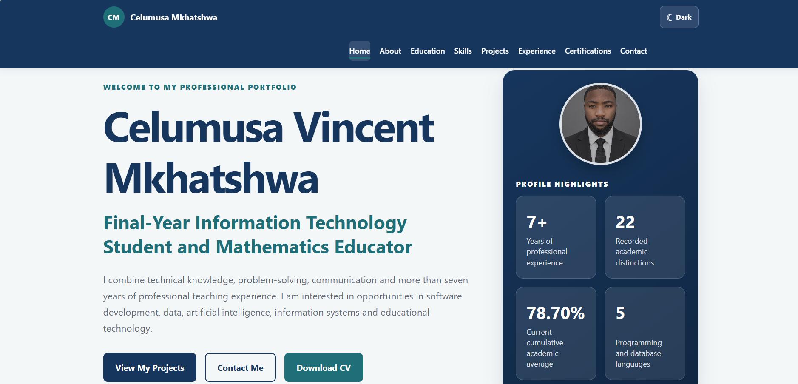

# Celumusa Vincent Mkhatshwa – Virtual CV

A responsive professional portfolio website presenting my education, technical skills, academic projects, professional experience, certifications and contact information.

## Live Website

[View the live Virtual CV](https://ccv254.github.io/virtual-cv/)

## Website Preview



## About the Project

This Virtual CV was developed as a professional online portfolio to complement my traditional CV, GitHub profile and LinkedIn profile.

I am a final-year Bachelor of Science in Information Technology student at North-West University and an experienced Mathematics educator. The portfolio highlights my technical skills, academic achievements, practical projects, professional experience and career interests, including software development, Power BI-supported business intelligence, database engineering, information security, artificial intelligence and Linux systems.

According to my current academic record, I have completed 328 of the required 392 qualification credits, achieved a cumulative GPA of 78.70% and recorded 22 distinctions across my studies.

## Main Features

- Responsive desktop, tablet and mobile design
- Professional light and dark themes
- Saved theme preference
- Mobile navigation menu
- Active navigation highlighting
- Smooth section navigation
- Professional profile photograph
- Downloadable PDF CV
- Back-to-top button
- GitHub and LinkedIn profile links
- Accessible keyboard navigation
- Reduced-motion accessibility support
- Responsive project, skills and education cards

## Technologies Used

- HTML5
- CSS3
- JavaScript
- Git
- GitHub
- GitHub Desktop
- Visual Studio Code
- GitHub Pages

## Website Sections

The Virtual CV contains the following sections:

1. Home
2. About Me
3. Education
4. Skills
5. Selected Projects
6. Professional Experience
7. Certifications
8. Contact Information

## Featured 2026 Projects

The portfolio now leads with five recent projects and practicals.

| Project | Focus | My work / scope |
| --- | --- | --- |
| PukParking | Full-stack campus parking navigation | Home, About Us, Parking Statistics, responsive UI, navigation, dark mode, integration assistance and documentation |
| Uber/Bolt Mobility Intelligence | Oracle SQL, analysis of 50,000 trips, Power BI | SQL-supported analysis and interpretation of **supplied** Power BI visuals; group report identified a 33.34% cancellation rate |
| MPBC Bicycle Inventory | Excel QM and decision support | EOQ, reorder point, safety stock and stock-cost analysis |
| AI Classification and Clustering | Python, scikit-learn, Teachable Machine | Three-class image classification and K-Means clustering with model evaluation |
| Ubuntu Linux Practical | VirtualBox, Ubuntu and Bash | VM setup, shared folders, terminal utilities and documented execution |

Power BI is presented as **visual analysis and interpretation** because the project documentation describes the charts as supplied; it does not establish authorship of the dashboards.

## Earlier Academic and Personal Projects


### 1. Municipal Complaint Management System

A web-based municipal system that enables community members to register complaints, track progress and view complaint status. Municipal administrators can allocate complaints, manage municipal services and generate filtered reports.

Technologies and concepts:

- C#
- ASP.NET
- SQL Server
- Database design
- Systems analysis
- Data reporting

The project includes complaint registration, allocation, tracking, service management and administrative reporting functionality.

### 2. CMA Fitness Management Database

A relational database solution designed to manage gym members, membership packages, bookings, trainers, payments, attendance, equipment and maintenance records.

Technologies and concepts:

- SQL
- Database design
- Relational modelling
- Normalization
- Database views
- Queries and reporting

The system was designed to replace manual files and spreadsheets with a centralised operational database for managing gym activities.

### 3. Burns Beach Physio Management System

A Windows and web-based system designed to support:

- Client registration
- Appointment booking
- Referrals
- Invoices
- Appointment rescheduling
- Administrative reporting

Technologies and concepts:

- Systems design
- User-interface development
- Web development
- Database integration
- Application development

### 4. Java Programming and Data Structures

A collection of Java applications demonstrating:

- Object-oriented programming
- Inheritance
- Interfaces
- Custom exceptions
- Array lists
- Linked lists
- Stacks
- Queues
- File handling

### 5. Professional Virtual CV

The Virtual CV website demonstrates:

- Semantic HTML structure
- Responsive CSS Grid and Flexbox layouts
- CSS custom properties
- Light and dark themes
- JavaScript event handling
- Local storage
- Mobile navigation
- Active-section tracking
- Accessible controls
- GitHub Pages deployment

## Academic Profile

**Qualification:** Bachelor of Science in Information Technology  
**Institution:** North-West University  
**Current status:** Final-year student  
**Expected completion:** 2026  
**NQF level:** 7  
**SAQA ID:** 73063  
**Credits completed:** 328 of 392  
**Current cumulative GPA:** 78.70%  
**Recorded distinctions:** 22  

Relevant coursework includes:

- Artificial Intelligence
- Databases
- Advanced Databases
- Computer Networks
- Operating Systems
- Decision Support Systems
- Data Analytics
- Data Structures and Algorithms
- Object-Oriented Programming
- Information Security
- Systems Analysis and Design
- User-Interface Programming

## Project Structure

```text
virtual-cv/
│
├── css/
│   └── style.css
│
├── documents/
│   └── Celumusa_Vincent_Mkhatshwa_CV.pdf
│
├── images/
│   ├── celumusa-profile-photo.png
│   ├── favicon.ico
│   └── virtual-cv-preview.png
│
├── js/
│   └── script.js
│
├── index.html
└── README.md
```

## Running the Website Locally

1. Download or clone the repository.
2. Open the `virtual-cv` project folder.
3. Open `index.html` in a web browser.

Alternatively, clone the repository using Git:

```bash
git clone https://github.com/CCV254/virtual-cv.git
```

Then open `index.html` inside the downloaded `virtual-cv` folder.

## Responsive Design

The website was tested on:

- Desktop screens
- Tablet-sized screens
- Mobile-phone screens
- Microsoft Edge
- Google Chrome

The layout adjusts automatically to different screen sizes using CSS media queries.

## Accessibility

Accessibility features include:

- Semantic HTML elements
- Descriptive alternative text
- Keyboard-visible focus indicators
- Skip-to-content link
- Accessible mobile-menu and theme controls
- ARIA labels and states
- Reduced-motion support
- Sufficient colour contrast
- Responsive text and controls

## Professional Profiles

- [GitHub Profile](https://github.com/CCV254)
- [LinkedIn Profile](https://www.linkedin.com/in/celumusa-mkhatshwa-08054617b/)
- [Live Virtual CV](https://ccv254.github.io/virtual-cv/)

## Contact

**Celumusa Vincent Mkhatshwa**

Johannesburg, South Africa

Email: [celumusa99@gmail.com](mailto:celumusa99@gmail.com)

## Author

Developed by **Celumusa Vincent Mkhatshwa**, a final-year Information Technology student and experienced Mathematics educator interested in software development, data, artificial intelligence, information systems and educational technology.